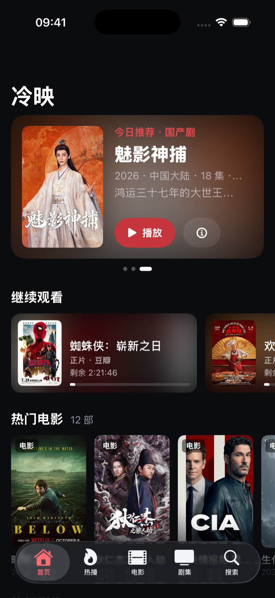
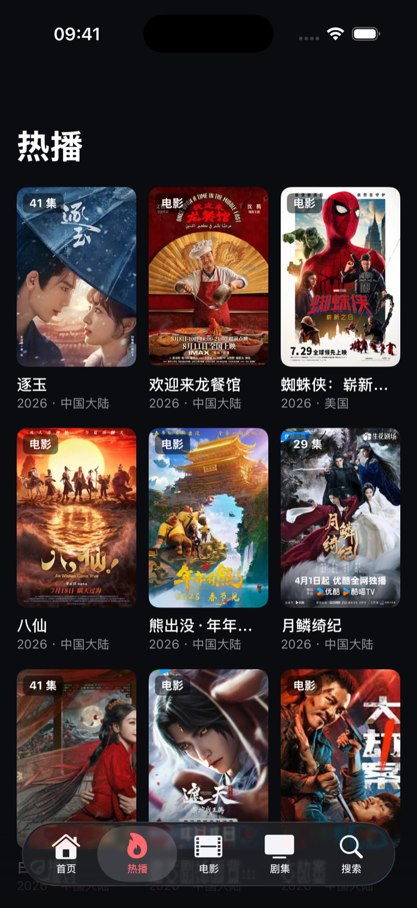
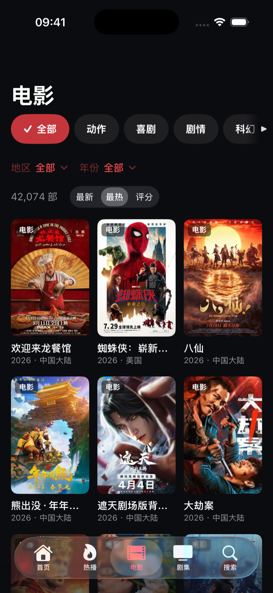
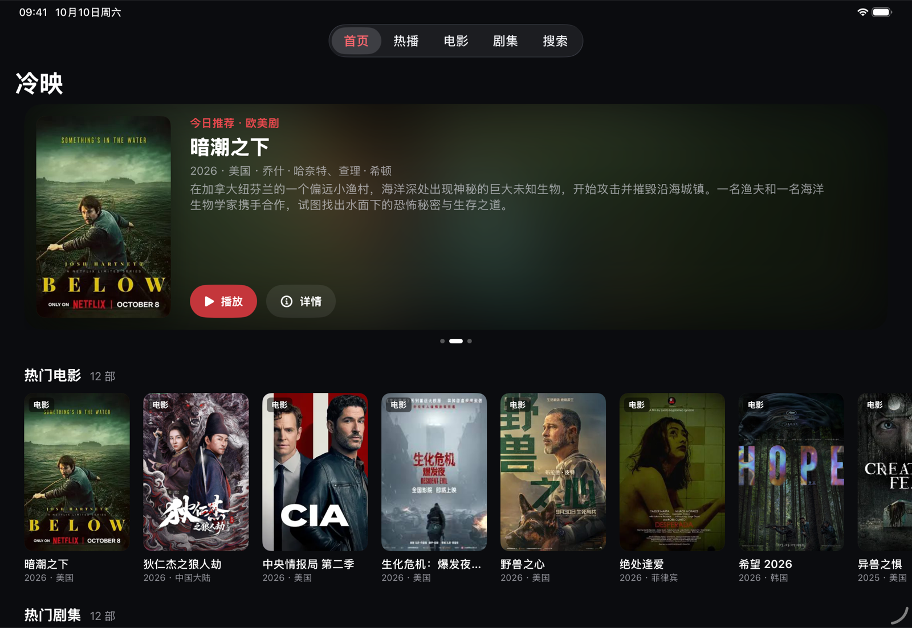

  

<h1 align="center">冷映 · LenTV</h1>

发现好电影，接着看好故事。

Apple TV · iPhone · iPad · Mac

冷映是一款面向 Apple TV、iPhone、iPad 和 Mac 的影视浏览与播放应用。发现想看的电影和剧集，选择播放线路，接着上次的进度继续观看。

## 界面预览

### iPhone

首页推荐与继续观看、热播榜单、分类筛选，随手找到想看的内容。

<table>
  <tr>
    <th width="33%">首页推荐</th>
    <th width="33%">热播榜单</th>
    <th width="33%">分类筛选</th>
  </tr>
  <tr>
    <td></td>
    <td></td>
    <td></td>
  </tr>
</table>

### Apple TV

在大屏上浏览推荐，查看影片资料，选择线路和集数。

### iPad

横屏展开推荐与海报列表，让更多内容一目了然。

## 发现想看的内容

- **首页推荐**：浏览今日推荐、热门电影和热门剧集，也可以从「继续观看」回到上次看到的位置。
- **热播榜单**：集中浏览热门电影与剧集，点击海报查看详情，向下滚动发现更多内容。
- **分类筛选**：按类型、地区、年份筛选电影和剧集；剧集还可按状态筛选，支持按最新、热度或评分排序。
- **片名搜索**：输入关键词查找电影和剧集，搜索结果随输入更新。
- **影片详情**：查看简介、评分、导演、主演和剧集更新信息，再选择线路与集数开始播放。

## 按自己的节奏观看

- **记录播放进度**：自动保存本机观看记录，下次打开时继续播放。
- **选集与连播**：随时选择想看的集数，当前集播放结束后自动播放下一集。
- **多线路切换**：播放中切换线路可保留进度；线路加载失败时，会尝试其他可用线路。
- **画中画**：iPhone、iPad 在支持的设备和系统设置下，可使用画中画边看边处理其他事情。

## 适合不同屏幕

| 设备 | 使用体验 |
| --- | --- |
| Apple TV | 遥控器浏览，大屏全屏播放，可在播放控制栏中切换线路和集数。 |
| iPhone | 随手浏览、搜索和播放，分类栏可左右滑动，右侧小三角提示还有更多选项。 |
| iPad | 更宽的内容展示空间，横屏时可一边观看，一边浏览影片资料和选集。 |
| Mac | 侧边栏切换栏目，使用鼠标、触控板或键盘浏览内容。 |

支持 tvOS 17、iOS / iPadOS 17、macOS 14 及以上版本。

## 刷新内容

首页可手动更新今日推荐、热门电影和热门剧集：

- **Apple TV**：在首页长按遥控器的播放／暂停键约 1 秒。
- **iPhone、iPad**：在首页下拉刷新。
- **Mac**：点击刷新按钮，或按 `⌘R`。

热播栏目也支持刷新：iPhone、iPad 下拉刷新，Apple TV 和 Mac 点击栏目中的刷新按钮。

首次进入首页会显示操作提示。勾选「不再提醒」后关闭，后续启动便不再提示；未勾选时，下次打开仍会显示。

---

影视内容与播放资源来自第三方服务，内容更新和线路可用性以实际情况为准。
